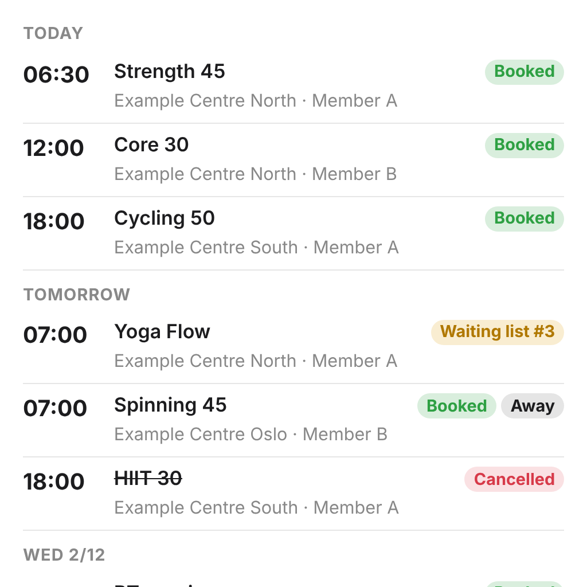

# SATS for Homey (unofficial)

Let Homey Flows react to your booked SATS group classes. For example: open the bedroom curtains
an hour before a morning class, but only if you're home and the class is near home.

> [!IMPORTANT]
> **This is an unofficial app. It is not affiliated with, endorsed by or supported by SATS
> (SATS ASA / SATS Group).** It uses the same private API as the SATS mobile app. SATS hasn't
> documented that API and **may change it at any time without notice**, and the app would stop
> working until it's updated. Use it only with your own SATS account, at your own risk.
> Login and the bookings call were verified against the live API on 2026-11-27; a few details
> are still unverified. See [docs/sats-api.md](docs/sats-api.md).

## Features

Each SATS member is a **device** in Homey (driver *SATS member*). Add one device per person,
each logged in with that member's own SATS account.

**Device Flow cards**

| Type | Card | Notes |
|------|------|-------|
| WHEN | *A booked class starts in [N] minutes* | Fires once per class, N minutes before it starts |
| WHEN | *A booked class ends* | Needs an end time or duration from SATS |
| WHEN | *A class was cancelled* | A booked **or waiting-list** class was marked cancelled by SATS (`cancelled_by` = `SATS`) or disappeared from your bookings (`cancelled_by` = `unknown`). Detected at the next poll |
| WHEN | *Moved from the waiting list to booked* | Tokens: class name, start, centre, previous position |
| WHEN | *Waiting list position changed* | Tokens: class name, start, centre, old position, new position |
| AND | *Class is within [N] km of home* | Distance from Homey's location to the class's centre |
| AND | *Class is at one of my home centres* | Compares with *Home centres* in the device settings |

The class triggers provide the tokens **class name, start, end, centre, city, country,
distance_km** (distance from home in km, or `-1` when unknown). *A class was cancelled* also
has **previous_status** (booked / waiting list) and **cancelled_by**.

The two device conditions check the class that triggered the Flow. If no trigger of this
member fired in the last 10 minutes, they check the member's next class instead.

**App Flow cards**

| Type | Card |
|------|------|
| AND | *Any member has a booked class before [time] today/tomorrow* |
| THEN | *Refresh bookings now* (all members) |

**Device values** (on the tile and device page; also usable in Flows, and the numbers are logged in Insights):

| Capability | Example |
|------------|---------|
| Next class | `Mon 06:30 Spinning, Example Centre`: the next **booked** class |
| Next waiting-list class | `Tue 07:00 Yoga, Example Centre (#3)`: the next class you're on the waiting list for, with your position |
| Booked classes | `3` upcoming booked classes |
| On waiting list | `1` |
| Best waiting-list position | `2`, or empty when not on any waiting list |

**Dashboard widget "SATS classes"** (Homey Dashboards). It lists the next 7 days for one
member or all members, picked in the widget settings. Columns: when, class, centre, who and
status (*Booked*, *Waiting list #N*, *Cancelled*). Classes further from home than a set
distance (default 10 km) get an *Away* badge. It updates as soon as bookings change, and every
5 minutes as time passes. It's built for a wall tablet: large type, no hover-only information.



**Timeline:** *moved to booked*, *waiting-list position changed* and *class cancelled* are also
posted to the Homey timeline. Turn this off under *Apps → SATS (unofficial) → Configure app*.

> Waiting-list places are part of the SATS bookings data, with their own booking state and a
> position field (seen live on 2026-11-27). The *moved to booked* and *position changed*
> transitions haven't been seen happen live yet.
> See [docs/sats-api.md](docs/sats-api.md#waiting-list-and-positions).
 Bookings are polled about every 30 minutes,
with ±10 % jitter. On errors the app retries after 2, 4, 8 … minutes, up to 4 hours between tries.
Waiting-list places and self-planned workouts never fire triggers.

## Install (from a Mac)

Requires a Homey Pro on firmware **12.3 or later** (needed for dashboard widgets).
The app isn't in the Homey App Store. Install it on your own Homey Pro with the Homey CLI:

1. Install Node.js LTS if you don't have it (for example from <https://nodejs.org> or with Homebrew):

   ```bash
   brew install node
   ```

2. Install the Homey CLI:

   ```bash
   npm install --global homey
   ```

3. Log in with your Homey account and select your Homey:

   ```bash
   homey login
   ```

4. Get the code:

   ```bash
   git clone https://github.com/magpern/homey-sats.git && cd homey-sats
   ```

5. Install the app on your Homey:

   ```bash
   homey app install
   ```

   To watch the log while testing, run `homey app run` instead. The app stays installed only
   while that command runs.

## Add a SATS member

1. In the Homey app: **Devices → + → SATS (unofficial) → SATS member**.
2. Log in with that member's **SATS member id or e-mail** and **SATS password**, the same ones
   used in the SATS app. The login is checked against SATS right away, and a wrong password
   shows an error.
3. Add the device and give it a name you'll recognise.
4. Repeat for every member in the household.

**Changed your SATS password, or the device says the session expired?** Open the device →
⚙️ → **Repair** and log in again. The device and its Flows stay as they are.

### What is stored

- **A refresh token, not your password.** The SATS login service returns a refresh token at
  login, so the app keeps only that token in the device's private store. The password is used
  once, during pairing or repair, and then discarded. The app asks for `offline_access`, so the
  token should outlive normal app sessions. How long SATS actually keeps it valid is
  unverified. When it expires, the device goes unavailable and asks you to repair it.
- Access tokens stay in memory only.
- Your bookings are cached in the device store so triggers still work if SATS is briefly unreachable.
- Centre locations (public data) are cached at app level.

Passwords, tokens, booking details and API responses are **never written to the log**, and
so never end up in Homey diagnostic reports. The log only shows counts, states and HTTP status codes.

### Device settings

- **Country**: the SATS market (Sweden, Norway, Denmark, Finland).
- **Home centres**: one centre name per line, for *Class is at one of my home centres*.
  Homey device settings have no multi-select, so the list underneath, *Centres in your bookings*,
  fills in automatically with the centres from your bookings. Copy names from there.
- **Look up centre locations with OpenStreetMap** (see below), on by default.
- **API path segment**: leave empty. The app uses the member id from your SATS login. It's
  only for troubleshooting if SATS changes its API
  ([docs](docs/sats-api.md#upcoming-booked-workouts-used-by-this-homey-app)).

## Distance from home

- **Home** is Homey's own location: *Homey app → Settings → Location*. It's read on the
  Homey and never sent anywhere.
- **Centre location**: if the SATS booking data includes the centre's coordinates, those are
  used. If it doesn't, the app geocodes the centre's address, or else its name and city, with
  OpenStreetMap Nominatim. Only the centre's public name/address is sent. Each centre is looked
  up once and cached, at most one request per second. Turn this off in the device settings if
  you prefer. Then the distance is unknown for those centres.
- In practice the SATS bookings data has only the centre's name (seen live on 2026-11-27, no
  coordinates or address), so the name is geocoded. When that finds nothing, `distance_km` is
  `-1` and *within N km* is **false**.

## Example Flow: open the bedroom curtains before a morning class

Replace the `<…>` placeholders with your own member device, Homey user and curtain devices:

```text
WHEN   <member>                  A booked class starts in 60 minutes      (this app)
AND    <user>                    is home                                   (Homey presence)
AND    <member>                  Class is within 10 km of home             (this app)
THEN   <bedroom curtain>         Open   (or: set position to 100 %)
       <other bedroom curtain>   Open
```

The two AND checks cover different cases:

- **"<user> is home"** handles *you're away on the day*, e.g. you slept somewhere else but still
  have a class booked near home. The curtains stay closed.
- **"Class is within 10 km of home"** handles *a class booked in another city*, e.g. an
  early class in Oslo during a work trip. You may not have left home yet, so presence alone
  would still open the curtains at home.

To limit the Flow to mornings, also add Homey's own *Date & time → The time is before 09:00*
condition. An evening class then never opens the curtains at 17:00.

## Only when you're actually home

This app does **not** check whether anyone is home and does **not** request Homey's
`homey:manager:api` permission. (The only permission it asks for is
`homey:manager:geolocation`, to read Homey's own location for the distance check.) Presence
stays an ordinary Flow condition, *"<user> is home"*, from Homey itself. So it works with
whatever presence method you use.

For reliable presence:

- Each member should install the **Homey mobile app**, log in as their own Homey user, and set
  the app's location permission to **"Always"** (iOS: *Settings → Homey → Location → Always*.
  Android: *Allow all the time*). Homey then sets the user home/away by geofence.
- Optionally add a **Wi-Fi presence app** from the Homey App Store as a backup. Note that
  phones often drop Wi-Fi at night to save battery, so with Wi-Fi alone a member can show as
  *away* early in the morning, exactly when this Flow runs. Use Wi-Fi as a secondary signal,
  not the only one.
- With several members, make one Flow per member, or use the app card *Any member has a booked
  class before [time] today/tomorrow* in a time-based Flow.
- Tokens such as *class name*, *centre* and *distance_km* work in notifications too, for
  example "Leave now for <class name> at <centre> (<distance_km> km)".

## Troubleshooting

| Device shows | Meaning / fix |
|--------------|---------------|
| *SATS session expired … Repair* | Refresh token expired or revoked (e.g. password changed). Repair the device and log in again. |
| Warning *No upcoming-workouts endpoint accepted the request* | The bookings path didn't work for your account; SATS may have changed its API. See [docs/sats-api.md](docs/sats-api.md) and open an issue, **without** pasting any personal data or tokens. |
| Warning with an HTTP status | SATS was unreachable or returned an error. The app retries with backoff by itself. |
| *Class is within N km* is always false | Check Homey's location, and that geocoding is on or SATS provides coordinates. |

## Development

```bash
npm test                         # unit tests (Node's built-in test runner, no dependencies)
homey app validate --level publish
homey app run                    # run on your Homey with live logs
```

Code layout:

- `lib/SatsClient.js`: auth and API
- `lib/bookings.js`: tolerant response parser
- `lib/scheduler.js`: trigger timing, waiting-list transitions and conditions
- `lib/geo.js`: distance and geocoding
- `lib/present.js`: next-class text and the widget data model
- `lib/MemberService.js`: per-member polling and backoff
- `drivers/member/`: Homey device and pairing
- `widgets/sats_classes/`: dashboard widget
- `app.js`: app-level cards, timeline and widget data

Test fixtures in `test/fixtures/` are **invented data**. Never commit real API responses or
captures: they contain personal data and tokens. `captures/`, `*.har` and similar are git-ignored.

## License

[MIT](LICENSE). SATS is a trademark of its owner. This project is not affiliated with SATS.
